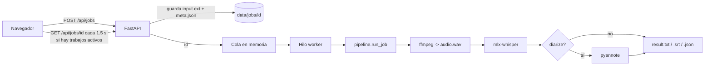

# Transcripciones locales

Aplicación web para subir audio o video y obtener su transcripción (TXT, SRT, JSON), con separación opcional de hablantes. Todo se procesa en la máquina local.

## Cómo correrla

Requisitos: macOS con Apple Silicon, Python 3.12, ffmpeg (`brew install ffmpeg`).

```fish
cd "/Users/santireycha/Documents/Santiago Reyes/TRANSCRIPTS"
python3.12 -m venv .env_santi                 # solo la primera vez
.env_santi/bin/pip install -r requirements.txt # solo la primera vez
.env_santi/bin/uvicorn app.main:app --host 0.0.0.0 --port 8000
```

Abrir `http://localhost:8000`. Desde otro equipo de la red: `http://<ip-del-mac>:8000`. Para detenerla, Ctrl+C.

La primera transcripción descarga el modelo Whisper (~1.6 GB) a la caché de Hugging Face; las siguientes no.

### Probar sin la web

```fish
curl -F file=@audio.m4a -F language=es localhost:8000/api/jobs
curl localhost:8000/api/jobs/<id>
curl -OJ localhost:8000/api/jobs/<id>/download/txt
```

### Activar la separación de hablantes

1. Crear un token en Hugging Face.
2. Aceptar las condiciones del modelo `pyannote/speaker-diarization-community-1`.
3. Poner el token en `HF_TOKEN` dentro de `.env` y reiniciar el servidor.

## Configuración (`.env`)

Se carga al iniciar con `python-dotenv`. `.env.example` es la plantilla.

| Variable | Por defecto | Uso |
|---|---|---|
| `HF_TOKEN` | vacío | Token de Hugging Face. Sin él, `diarize=true` se rechaza con HTTP 400. También acelera las descargas. |
| `WHISPER_MODEL` | `mlx-community/whisper-large-v3-turbo` | Repo de Hugging Face del modelo Whisper en formato MLX. |
| `DIARIZATION_DEVICE` | `cpu` | Dispositivo de pyannote: `cpu` o `mps`. |
| `MAX_UPLOAD_MB` | `500` | Tamaño máximo por archivo. |
| `APP_PASSWORD` | vacío | Si se define, todas las rutas exigen HTTP Basic con esa contraseña. |

## Componentes

| Componente | Función |
|---|---|
| FastAPI + Uvicorn | Servidor HTTP y API REST. |
| python-multipart | Lectura de la subida de archivos (`multipart/form-data`). |
| python-dotenv | Carga de `.env`. |
| ffmpeg | Convierte la entrada a WAV 16 kHz mono (para Whisper) y a MP3 liviano (para el reproductor). |
| mlx-whisper | Transcripción con Whisper sobre la GPU de Apple Silicon (MLX). |
| pyannote.audio ≥ 4 | Diarización con el modelo `speaker-diarization-community-1`. |
| PyTorch, NumPy | Dependencias de pyannote; NumPy lee el WAV como arreglo. |
| HTML + JavaScript | Interfaz de una sola página, sin framework. |
| Tailwind CSS v4 (CLI) | Estilos. Se compilan a un CSS estático; el navegador no necesita internet. |

## Estructura

```
.env / .env.example     configuración
requirements.txt        dependencias
app/
  __init__.py
  main.py               servidor, cola, endpoints, autenticación
  pipeline.py           conversión, transcripción, diarización, formatos de salida
  static/
    index.html          estructura de la página
    app.js              interfaz (inicio y visor)
    src/input.css       entrada de Tailwind
    tailwind.css        CSS compilado (versionado)
scripts/build_css.sh    compila Tailwind
data/jobs/<id>/         un directorio por trabajo (se crea al ejecutar)
```

## Arquitectura



### `app/main.py`

- **Cola**: `queue.Queue` en memoria con un único hilo `worker` (daemon), iniciado en el `lifespan`. Un trabajo a la vez para no saturar la GPU ni la RAM.
- **Estado por trabajo**: `data/jobs/<id>/meta.json`, escrito con `write_meta` bajo un `threading.Lock`. Campos: `id`, `filename`, `status` (`queued`, `processing`, `done`, `error`), `stage` (`queued`, `starting`, `converting`, `transcribing`, `diarizing`, `done`), `progress` (0 a 1 durante `transcribing`, `null` en el resto), `audio_seconds`, `language`, `diarize`, `num_speakers`, `created_at`, `error`.
- **Recuperación**: al arrancar, los trabajos en `queued` o `processing` vuelven a `queued` y se reencolan.
- **Autenticación**: dependencia global `auth`. Si hay `APP_PASSWORD`, exige HTTP Basic y compara solo la contraseña con `secrets.compare_digest`; el usuario no se valida.
- **Validaciones de subida**:
  - extensión dentro de una lista permitida;
  - tamaño leído por bloques de 1 MB contra `MAX_UPLOAD_MB` (HTTP 413 y borrado del directorio si se excede);
  - `language` debe ser de 2 o 3 letras minúsculas;
  - `diarize` exige `HF_TOKEN`.
- **Identificadores**: `uuid4().hex`, validados con la regex `^[0-9a-f]{32}$` antes de tocar el sistema de archivos. Esto evita path traversal. El archivo se guarda como `input<ext>`, nunca con el nombre original.
- **Edición**: `PUT /api/jobs/{id}/transcript` recibe solo los textos, en la misma cantidad que los segmentos, así que no se pueden alterar tiempos ni hablantes. Normaliza espacios, guarda `result.original.json` la primera vez y regenera TXT, SRT y JSON con `write_outputs`.
- **Estáticos**: `/static` es un montaje y queda fuera de la dependencia global de autenticación; solo sirve CSS y JS. La página (`/`) y la API sí la exigen.

### `app/pipeline.py`

- `to_audio`: una sola llamada a ffmpeg que genera `audio.wav` (16 kHz mono, para Whisper) y `preview.mp3` (mono 64 kbps, para el reproductor; así funciona con cualquier formato de entrada).
- `transcribe`: `mlx_whisper.transcribe` con `verbose=True` devuelve segmentos con `start`, `end` y `text`; se descartan los vacíos. `mlx_whisper` no tiene callback de progreso, así que `_SegmentTee` intercepta `stdout`, lee el fin de cada segmento impreso (`[inicio --> fin]`) y calcula `fin / duración`. Solo se guarda cuando cambia el porcentaje entero. Si una versión futura cambia ese formato, la barra queda indeterminada pero la transcripción sigue funcionando.
- `diarize`: pyannote se carga una sola vez (variable global con lock) y se mueve al dispositivo configurado. El WAV se lee con el módulo `wave` y se pasa como tensor `{"waveform", "sample_rate"}`, lo que evita depender del decodificador de audio de pyannote. Se usa `exclusive_speaker_diarization` si existe, para que los turnos no se solapen.
- `assign_speakers`: a cada segmento de Whisper se le asigna el hablante con mayor solapamiento temporal; si no hay solapamiento, queda sin etiqueta.
- Salidas: `write_outputs` genera `result.json`, `result.txt` y `result.srt`. El `result.json` conserva los segmentos y añade `speaker_name` cuando el hablante fue renombrado. El TXT agrupa los segmentos en turnos (`group_turns`: cambia el hablante, hay una pausa de más de 3 s o el párrafo pasa de 800 caracteres) con el formato `[HH:MM:SS] Nombre: texto`. El SRT mantiene un cartel por segmento. Sin renombrar, las salidas usan la etiqueta original (`SPEAKER_00`). El `audio.wav` temporal se borra al terminar; `input.<ext>` y `preview.mp3` se conservan.

### `app/static/app.js` y `index.html`

Página única con routing por hash. Los elementos se construyen con la función `h()` y `textContent`, nunca con `innerHTML`, así que un nombre de archivo no puede inyectar HTML.

- **Inicio (`#/`)**: zona de arrastrar y soltar (varios archivos), opciones de idioma y hablantes, barra de avance de la subida (`XMLHttpRequest`) y tarjetas por archivo con etapa, porcentaje y botones Ver, TXT, SRT y JSON. Los ids de tus trabajos viven en `localStorage`, por lo que cada persona solo ve lo que subió desde su navegador. Un id que el servidor ya no conoce se descarta solo. "Quitar" solo saca la tarjeta de la lista; no borra nada del servidor.
- **Visor (`#/t/<id>`)**: reproductor fijo arriba (velocidad, ±10 s) y transcript en párrafos por turno de hablante, con un color por hablante. Cada frase sigue siendo un elemento propio: clic en una frase salta a ese momento y la que suena se resalta (búsqueda binaria sobre `timeupdate`), con la opción "Seguir reproducción". La regla de agrupación (`groupTurns`) debe coincidir con `group_turns` del servidor. Clic en el nombre de un hablante lo renombra (Enter guarda, Esc cancela; vacío restablece "Hablante N"). Botones Copiar, TXT, SRT, JSON y Editar. En modo edición cada frase es editable en su lugar, el botón Guardar muestra cuántas cambiaron y se avisa antes de salir con cambios sin guardar. Atajos: Espacio pausa o reanuda, flechas ±5 s.
- Las descargas reflejan lo guardado; con cambios pendientes se pide guardar antes.

### Estilos (Tailwind)

Las clases están escritas literalmente en `index.html` y `app.js`, y Tailwind compila solo las que se usan. Tras cambiar clases hay que recompilar (requiere `brew install tailwindcss`):

```fish
scripts/build_css.sh          # una vez
scripts/build_css.sh --watch  # mientras desarrollas
```

`app/static/tailwind.css` está versionado, así que para solo ejecutar la app no hace falta el CLI.

El color principal (naranja) es el token `brand-50` a `brand-700`, definido en `@theme` dentro de `app/static/src/input.css`. Para recolorear toda la interfaz basta cambiar esos valores y recompilar.

## API

| Método y ruta | Descripción |
|---|---|
| `GET /` | Interfaz web. |
| `POST /api/jobs` | Campos: `file`, `language` (opcional), `diarize` (bool), `num_speakers` (opcional). Devuelve `{"id": "..."}`. |
| `GET /api/jobs/{id}` | Devuelve `id`, `filename`, `status`, `stage`, `error`, `progress`, `audio_seconds`, `diarize` y `created_at`. |
| `GET /api/jobs/{id}/transcript` | Segmentos (`start`, `end`, `text`, `speaker`), `speaker_names` y metadatos. Solo si el trabajo está en `done` (409 si no). |
| `PUT /api/jobs/{id}/transcript` | Cuerpo `{"texts": [...]}` con un texto por segmento. Edita solo el texto y regenera TXT, SRT y JSON. |
| `PUT /api/jobs/{id}/speakers` | Cuerpo `{"names": {"SPEAKER_00": "Ana"}}`. Renombra hablantes (un nombre vacío restablece el predeterminado) y regenera TXT, SRT y JSON. |
| `GET /api/jobs/{id}/audio` | Audio para el reproductor (`preview.mp3`, o el original en trabajos antiguos). Admite `Range`. |
| `GET /api/jobs/{id}/download/{fmt}` | `fmt` = `txt`, `srt` o `json`. Solo si el trabajo está en `done`. |

## Limitaciones conocidas

- La cola vive en memoria: reiniciar el servidor reencola lo pendiente, pero un trabajo a medias empieza de cero.
- Los archivos en `data/jobs/` no se borran automáticamente.
- Un solo worker: los archivos largos retrasan a los demás.
- HTTP Basic sin HTTPS viaja sin cifrar. Para exponerla fuera de la red local, usar un túnel con HTTPS (Tailscale, Cloudflare Tunnel) o un proxy inverso.
- Cualquiera que conozca el id de un trabajo puede ver el transcript, escuchar el audio, descargarlo y editarlo; los ids no se pueden adivinar, pero no hay control de usuarios.
- Las ediciones sobrescriben `result.*`. La copia original queda en `result.original.json` en el servidor, sin botón para restaurarla.
- La diarización en CPU es lenta con audios largos.
